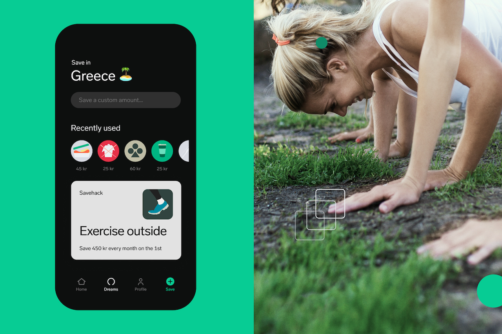

# Dreams Android SDK



## Requirements

* Minimum Android SDK version: 21
* Compile/target SDK version: 36
* Java source and target compatibility version: 17

## Breaking changes in 1.0.0

`DreamsView` now handles window insets and back navigation itself, so that every
integration is correct on Android 15+ without per-app workarounds. If your app
already implements these, **remove your version** or you will get double handling.

**1. System bar insets are applied by the SDK**

`DreamsView` sets its own padding from `systemBars` insets. Remove any inset
listener you attach to the Dreams view:

```kotlin
// Remove this — the SDK does it now
ViewCompat.setOnApplyWindowInsetsListener(dreamsView) { view, insets ->
    val bars = insets.getInsets(WindowInsetsCompat.Type.systemBars())
    view.setPadding(bars.left, bars.top, bars.right, bars.bottom)
    insets
}
```

Your Activity is still responsible for opting into edge-to-edge itself
(`WindowCompat.setDecorFitsSystemWindows(window, false)`), which is mandatory
on API 35+ regardless.

**2. Back navigation is handled by the SDK**

`DreamsView` registers its own `OnBackPressedCallback` while attached, enabled
only when the WebView has history. Remove your own callback:

```kotlin
// Remove this — the SDK does it now
onBackPressedDispatcher.addCallback(this, object : OnBackPressedCallback(true) {
    override fun handleOnBackPressed() {
        if (dreamsView.canGoBack()) dreamsView.goBack() else { /* ... */ }
    }
})
```

This is what makes Predictive Back render the correct preview: the callback is
disabled when there is no history, so the system shows the return-to-launcher
animation instead of an in-app one. Keeping a permanently-enabled callback of
your own defeats that.

**If your callback also did something else, keep that part.** A common case is
hosting Dreams in a Fragment, where the same callback both navigated the WebView
and left the Dreams screen. Only the WebView half should go:

```kotlin
private val onBackPressed = object : OnBackPressedCallback(false) {
    override fun handleOnBackPressed() {
        // Removed — the SDK handles this now:
        // if (dreams.canGoBack()) { dreams.goBack() } else { ... }

        // Kept — still your responsibility:
        findNavController().navigateUp()
    }
}
```

The SDK's callback is enabled only while the WebView has history, so it takes
the press first and yours runs once there is nowhere left to go back to.

`canGoBack()` and `goBack()` remain public if you need manual control.

**3. Keyboard insets are handled on API 35+**

> **Bug fix** — resolves the reported issue where the soft keyboard slid up but
> the WebView content underneath did not move, leaving input fields hidden on
> Android 15+.

On API 35+, `adjustResize` is ignored because edge-to-edge is mandatory, so the
SDK now drives WebView padding from the IME animation instead. Keep
`adjustResize` in your manifest — it is still required on API 21–34.

Set `android:enableOnBackInvokedCallback="true"` on your `<application>` to opt
into Predictive Back.

## Installation

Register the maven repository by adding it to your project build.gradle.

```groovy
allprojects {
    repositories {
        mavenCentral()
    }
}
```

Add the library to your module dependencies.

```groovy
dependencies {
    implementation 'io.github.doconomy:dreams-android-sdk:1.0.0'
}
```

## Usage

Before using any other part of the SDK you must call `Dreams.configure()`. This can be done in `Application.onCreate()`.

```kotlin
class ExampleApp : Application() {
    override fun onCreate() {
        super.onCreate()
        Dreams.configure(Dreams.Configuration(clientId = "clientId", baseUrl = "https://getdreams.io"))
    }
}
```

To show Dreams simply add `DreamsView` to a layout, and then call `DreamsView.launch()`.
To handle possible errors during launch you can send a `OnLaunchCompletion` to `DreamsView.launch()` that will be invoked with the result of the launch.

```xml
<com.getdreams.views.DreamsView
    android:id="@+id/dreams"
    android:layout_width="match_parent"
    android:layout_height="match_parent" />
```

```kotlin
val dreamsView: DreamsView = findViewById<DreamsView>(R.id.dreams)
dreamsView.launch(Credentials(idToken = "user token"), launchConfig = LaunchConfig(locale = Locale.ENGLISH)) { result ->
    when (result) {
        is Result.Success -> {
            // Dreams was launched successfully
        }
        is Result.Failure -> {
            when (val err = result.error) {
                is LaunchError.InvalidCredentials -> {
                    // The provided credentials were invalid
                }
                is LaunchError.HttpError -> {
                    // The server returned a HTTP error code
                }
                is LaunchError.UnexpectedError -> {
                    // Something went wrong when trying to open a connection to Dreams
                }
            }
        }
    }
}
```

The dreams view can trigger showing the IME, e.g. a soft keyboard, so it needs to be
resized to avoid the IME covering part of it. On API 35+ the SDK handles this itself.
On API 21–34 you still need to flag the activity as `adjustResize`.

```xml
<activity
    android:name=".Example"
    android:windowSoftInputMode="adjustResize"/>
```

### Location

If you want to launch dreams at a specific location you need to send a `location` to `DreamsView.launch`.

```kotlin
val dreamsView: DreamsView = findViewById<DreamsView>(R.id.dreams)
dreamsView.launch(Credentials(idToken = "user token"), location = "/path/to/location", launchConfig = LaunchConfig(locale = Locale.ENGLISH)) { _ -> }
```

When the dreams view is already active the `DreamsView.navigateTo()` function can be used instead.

```kotlin
val dreamsView: DreamsView = findViewById<DreamsView>(R.id.dreams)
dreamsView.navigateTo(location = "/path/to/location")
```

### Events

In order to listen for events from Dreams you need to register a listener on the DreamsView.

```kotlin
dreamsView.registerEventListener { event ->
    when (event) {
        is Event.Telemetry -> { /* Use telemetry event */ }
    }
}
```

#### Token renewal

When a token requires renewal a `CredentialsExpired` event will be sent, to set a new token you need to call
 `DreamsView.updateCredentials` with the request id from the event and the new token.

 ```kotlin
dreamsView.registerEventListener { event ->
    when (event) {
        is Event.CredentialsExpired -> {
            val newToken = getValidToken()
            dreamsView.updateCredentials(requestId = event.requestId, credentials = Credentials(idToken = newToken))
        }
    }
}
```

## Documentation

You can generate documentation by running the relevant Dokka task.

```shell script
./gradlew sdk:dokkaHtml sdk:dokkaJavadoc
```

## Testing

### Unit tests

```shell script
./gradlew sdk:test
```

### Device tests

```shell script
./gradlew sdk:connectedCheck
```

## Development

Simply clone the repo and open the project in Android Studio 4.0 or later.

### Preparing a Release

Simplest way is to use [standard-version](https://github.com/conventional-changelog/standard-version#cli-usage), with it you just need to run:

```shell script
npx standard-version
```

Or manually update the versions in [sdk/build.gradle](./sdk/build.gradle) and [README.md](./README.md). Then make a release tag.

### Publishing

To publish the library to your local maven, simply run:

```shell script
./gradlew sdk:publishToMavenLocal
```

This will publish aar, html-doc, javadoc, and sources to the local maven.

To publish to Maven Central you need signing key details and credentials in gradle properties.
In your local `~/.gradle/gradle.properties`, outside version control, *not to be committed*:

```properties
signing.keyId=
signing.password=
signing.secretKeyRingFile=

mavenCentralUsername=
mavenCentralPassword=
```

To publish a new package to Maven Central you can then run:

```shell script
./gradlew sdk:publishToMavenCentral
```

## Changelog

See [CHANGELOG.md](./CHANGELOG.md).
